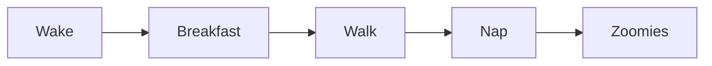

<!-- Check: the front matter above is not shown in the Read Aloud Preview and is never read aloud. -->

# The Wagyu Field Guide


Wagyu was a red **Shiba Inu** with a cream chest, white socks and a bright yellow harness. This guide
uses him to test *every* part of Markdown that **AI Markdown Reader** reads aloud: headings, lists,
tables, images, links, code and more. If anything below sounds wrong, it's a bug, not a Shiba.

<!-- Check: the image is read as "Image: Wagyu, a red Shiba Inu, reading a Markdown page aloud".
Bold and italic words are read without their asterisks and highlighted one word at a time. -->

## Contents

1. [Meet Wagyu](#meet-wagyu)
2. [Quick facts](#quick-facts)
3. [Daily routine](#daily-routine)
4. [Packing list](#packing-list)
5. [Code corner](#code-corner)
6. [Gallery](#gallery)
7. [Links and HTML](#links-and-html)
8. [Edge cases](#edge-cases)

<!-- Check: numbered items are read with their numbers ("1. Meet Wagyu."). In the Read Aloud Preview,
clicking a link scrolls to that section. -->

## Meet Wagyu

The Shiba Inu is the smallest of Japan's native spitz breeds, and its name is often said to mean
"brushwood dog". Shibas are clean, quiet and famously independent. Wagyu was all three, until the
doorbell rang.

Then came the *Shiba scream*: a dramatic yodel that sounds far bigger than a dog of 8–11 kg
(17–23 lb). Wagyu woke the house at 6:30 AM, reviewed 100% of the naps, and treated the $12.50
weekly treat budget as a suggestion, e.g. by finding the treat jar, i.e. every single day.

His imaginary smart collar ran firmware v2.4.1, logged each sprint with `countZoomies()`, and sent
the totals to the IoT dashboard as JSON over HTTPS. The `ShibaZoomTracker` reported 3–5 zoomies on a
good evening and stored them in `zoomies_per_day`.

<!-- Check: numbers, units, money, times, percentages, versions, acronyms (IoT, JSON, HTTPS) and
identifiers (ShibaZoomTracker as "Shiba Zoom Tracker") sound natural. "e.g." and "i.e." do not end
the sentence. -->

Wagyu's mailing address, one line at a time:  
The sunny spot by the window  
Under the desk, behind the cables\
Care of the couch

<!-- Check: the hard line breaks above (two trailing spaces, and a backslash) are read as one
flowing sentence and shown as separate lines in the preview. -->

### Quick facts

| Fact | Wagyu | Typical Shiba Inu |
| :--- | :---: | ---: |
| Coat | Red, with a cream chest and white socks | Red, sesame, black and tan, or cream |
| Weight | | 8–11 kg |
| Favorite toy | An empty **water bottle** | Anything that squeaks |
| Office | Under the desk | Wherever you are sitting |
| Harness | Yellow | A strong one |
| Motto | `if (treat) sit();` | Stubborn \| independent |
| More | [Shiba Inu on Wikipedia](https://en.wikipedia.org/wiki/Shiba_Inu) | Ask any Shiba owner |

<!-- Check: the table starts with "Table with 7 rows. Columns: Fact, Wagyu, Typical Shiba Inu." Then
each row is read with its column names, for example "Coat. Wagyu: Red, with a cream chest and white
socks. Typical Shiba Inu: Red, sesame, black and tan, or cream." The empty Weight cell is read as
"empty", and the escaped pipe is silent. The row is highlighted, and each cell and its column name
light up as they are read. Press → in the player to skip the whole table; Shift+→ steps row by row.
A "Describe this table with Copilot" link appears above the table while the file is being read. -->

### The Shiba scream

> Shibas rarely bark. When they object, the whole street hears about it.
>
> > Wagyu preferred a long, theatrical sigh.

<!-- Check: both quotes are announced with "Quote:". -->

### Five things every Shiba owner learns

> [!NOTE]
> Shibas shed their whole undercoat about twice a year. Owners call it "blowing coat".

> [!TIP]
> A puzzle feeder turns breakfast into a ten-minute game.

> [!IMPORTANT]
> Always use a well-fitted harness. Shibas are escape artists.

> [!WARNING]
> Never leave food on the coffee table. Wagyu certainly never left any there.

> [!CAUTION]
> Bath time is a negotiation, and the Shiba always believes he is winning.

<!-- Check: each alert starts with its type ("Note:", "Tip:", "Important:", "Warning:", "Caution:"),
and the preview shows a colored bar and a title for each. -->

## Daily routine

6. Wake up at 6:30 AM and stare at the bed until someone notices.
7. Breakfast:
   - Kibble with a spoonful of pumpkin.
   - A carrot, but only if begged for.
8. A walk around the block.

   On rainy days, refuse to go out. Reconsider in ten minutes.
9. Nap under the desk, guarding the cables.
10. Zoomies, at exactly 8:00 PM.

<!-- Check: numbering starts at 6 and is read aloud. Nested bullets are read in order, without the
word "bullet". The rainy-day paragraph under step 8 is read after it. -->

## Packing list

- [x] Yellow harness
- [x] Poop bags
- [ ] Empty water bottle, for chewing
- [ ] Treat pouch (check that it's full)

<!-- Check: read as "Completed: Yellow harness." and "Not completed: Empty water bottle, for
chewing."; the preview shows checkboxes. -->

### Tricks he knew

* **Sit:** reliable, unless a squirrel was involved.
* **Shake:** only for cheese.
  + **High five:** a variation of shake, also only for cheese.
* **Come:** a suggestion rather than a command.

<!-- Check: labelled bullets flow as sentences, for example "Sit: reliable, unless a squirrel was
involved." -->

## Code corner

Wagyu's day, as JavaScript:

```js
function wagyuDay(hour) {
  if (hour === 20) return 'zoomies';
  return hour < 7 ? 'sleep' : 'supervise';
}
```

The same day in Python:

```python
def wagyu_day(hour: int) -> str:
    if hour == 20:
        return "zoomies"
    return "sleep" if hour < 7 else "supervise"
```

A shell command:

```bash
echo "Who's a good boy?" | tee wagyu.log
```

His profile:

```json
{ "name": "Wagyu", "breed": "Shiba Inu", "harness": "yellow" }
```

A Kusto query over his activity log:

```kql
DogActivity
| where Dog == "Wagyu"
| summarize Zoomies = count() by bin(Timestamp, 1d)
```

His routine as a diagram:



An indented code block:

    sit();
    stay();
    treat();

A code block with no language:

```
Wagyu was here.
```

<!-- Check: with "Code blocks: Announce" (the default) each block is announced, for example "Code
block, JavaScript, 4 lines", "Code block, Kusto query, 3 lines" and "Diagram, 2 lines", and the whole
block is highlighted. With "Read aloud" they are read line by line; with "Skip" they are silent. -->

## Gallery


[](https://github.com/Orexii/ai-markdown-reader)

A remote image: 

A reference-style image: ![Wagyu by reference][wagyu-icon]

<!-- Check: images are read as "Image:" and their description; the one without a description is read
as "Image". All five show in the Read Aloud Preview (the remote one needs an internet connection). -->

## Links and HTML

- An inline link: [the American Kennel Club's Shiba page](https://www.akc.org/dog-breeds/shiba-inu/ "American Kennel Club").
- A reference link: [Shiba Inu on Wikipedia][shiba-wiki].
- An autolink: <https://www.akc.org/dog-breeds/shiba-inu/>
- A bare web address: https://en.wikipedia.org/wiki/Shiba_Inu
- An email address: <wagyu@example.com>
- A link to a heading in this file: [back to Quick facts](#quick-facts).
- A link to another file: [the short demo](demo.md).

<!-- Check: link text is read, never the address; the autolink and the bare address read just the
site name ("akc.org", "en.wikipedia.org"). In the preview, web links open in the browser, the
heading link scrolls, and the file link opens demo.md. -->

Press <kbd>Space</kbd> to pause, or <kbd>→</kbd> to skip to the next paragraph.<br>Wagyu drank from
his bowl, never from the bottle.

<details><summary>A secret, hidden in HTML</summary>He always knew where the treats were.</details>

<!-- This comment is invisible in the preview and is never read aloud. -->

<script>alert('This must never run.')</script>

<!-- Check: the <kbd> keys are read as words, and <br> is a pause. The collapsible "details" block
shows in the preview but is not read. The script never runs: no alert appears. -->

---

## Edge cases

#### Level four: ears

##### Level five: tail

###### Level six: toe beans

A setext heading
================

Another setext heading
----------------------

Escaped characters stay literal: \*not italic\*, \# not a heading, and 2 \* 3 = 6.

Emoji are shown but not read: Wagyu loved bones 🦴 and sweet potatoes 🍠.

A very long sentence checks that long sentences are split smoothly at commas without losing a word:
Wagyu supervised the morning coffee, inspected the delivery driver, guarded the sunny spot by the
window, negotiated a second breakfast, ignored the squirrel on the fence for exactly eleven seconds,
chased the same squirrel along the fence for considerably longer, came home with a stick nobody had
asked for, and then fell asleep under the desk with his paws twitching as if he were still running.

<!-- Check: heading levels 4 to 6 and both setext headings are read as headings. Escaped asterisks
are not read as symbols. The emoji are silent. The long sentence plays without a gap where it is
split. Press Shift+↓ in the player to jump from heading to heading. -->

## The end

That's the whole tour. Wagyu would like a treat now.

[shiba-wiki]: https://en.wikipedia.org/wiki/Shiba_Inu
[wagyu-icon]: images/wagyu.png "Wagyu"
